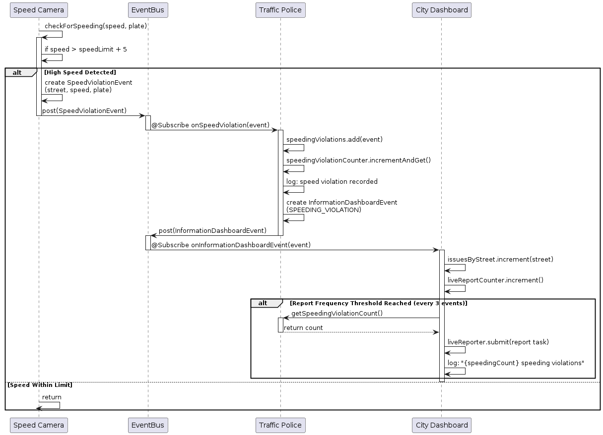

# Smart City Surveillance

A Java 21 console simulation of event-driven city monitoring. Independent camera tasks publish typed events through Greenrobot EventBus; police subscribers record incidents, navigation subscribers react to congestion, and a dashboard logs aggregate reports.

This coursework project demonstrates publish/subscribe communication and concurrency. Observations are generated in code. Waze, Google Maps, and Apple Maps are simulated subscribers, with no connection to their real services.

## Event flow

| Publisher | Event | Subscribers and result |
| --- | --- | --- |
| Four speed cameras | `SpeedViolationEvent` | Traffic police record vehicles exceeding the local limit by more than 5 km/h, then notify the dashboard. |
| Three surveillance cameras | `PublicDisorderEvent` | Local police record simulated incidents, then notify the dashboard. |
| Four traffic cameras | `TrafficCongestionEvent` | Three navigation subscribers log changed congestion levels and notify the dashboard. |
| Police and navigation subscribers | `InformationDashboardEvent` | The dashboard counts speeding/disorder issues per location and queues reports; congestion notifications are currently ignored. |

`Program` registers subscribers, submits eleven camera tasks to a fixed thread pool, waits for completion, drains the dashboard reporter, and unregisters subscribers. EventBus handlers use default posting-thread delivery: they execute on the publishing camera threads. The dashboard uses a separate single-thread executor for reports.

Atomic counters, synchronized incident lists, and concurrent maps support concurrent updates. Reports are requested after every three counted issues; a location ranking is requested at every ninth issue. Random observations make counts and log ordering vary between runs.

## Requirements

- JDK 21 or later, with `java` and `javac` available.
- Apache Maven, with dependency access for the first build.

Dependencies in `pom.xml`: Greenrobot EventBus 3.3.1, SLF4J 2.0.9, and Logback 1.4.11. Maven Shade includes dependencies in the executable JAR.

## Build and run

From this directory:

```sh
mvn clean package
java -jar target/smart-city-surveillance-1.0-SNAPSHOT.jar
```

From the Small-Projects root:

```sh
mvn -f SmartCitySurveillanceSystem/pom.xml clean package
java -jar SmartCitySurveillanceSystem/target/smart-city-surveillance-1.0-SNAPSHOT.jar
```

The program performs one finite simulation and exits automatically. Output goes to the console; `src/main/resources/logback.xml` controls verbosity. INFO shows dashboard reports and shutdown messages; individual police records use DEBUG. No database, broker, camera hardware, credentials, or external API is required at runtime.

## Source layout

- `src/main/java/city/Program.java`: wiring, observations, task execution, and shutdown.
- `*Camera.java` and `*Event.java`: publishers and event payloads.
- `TrafficPolice.java`, `LocalPolice.java`: incident recording and notifications.
- `NavigationApp.java`, `Waze.java`, `GoogleMaps.java`, `AppleMaps.java`: navigation subscriber abstraction and implementations.
- `CityInformationDashboard.java`: counters, location rankings, and report scheduling.
- `sequence_diagram_code.txt`: diagram source.
- `sequence_diagram_speed_camera.png`: rendered speed-camera sequence.



## Scope and limitations

- All components run inside one JVM; communication uses an in-process event bus.
- There is no video processing, live surveillance, map routing, persistent storage, or graphical dashboard.
- The dashboard's congestion map is never populated, and congestion notifications do not contribute to issue counts.
- Incident-list getters copy synchronized lists without explicitly locking around the copy; concurrent snapshot safety has not been established.
- No automated tests are included. A successful Maven build verifies compilation and packaging, not concurrency correctness.

This directory is the portfolio copy of `PASSC/Smart City Surveillance`. Source, Maven configuration, and diagrams are retained. Nested Git history and generated `target/` output are excluded from the copy; build products and local editor artifacts are ignored.
